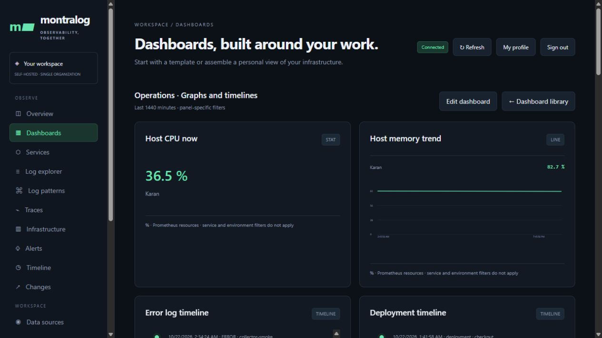
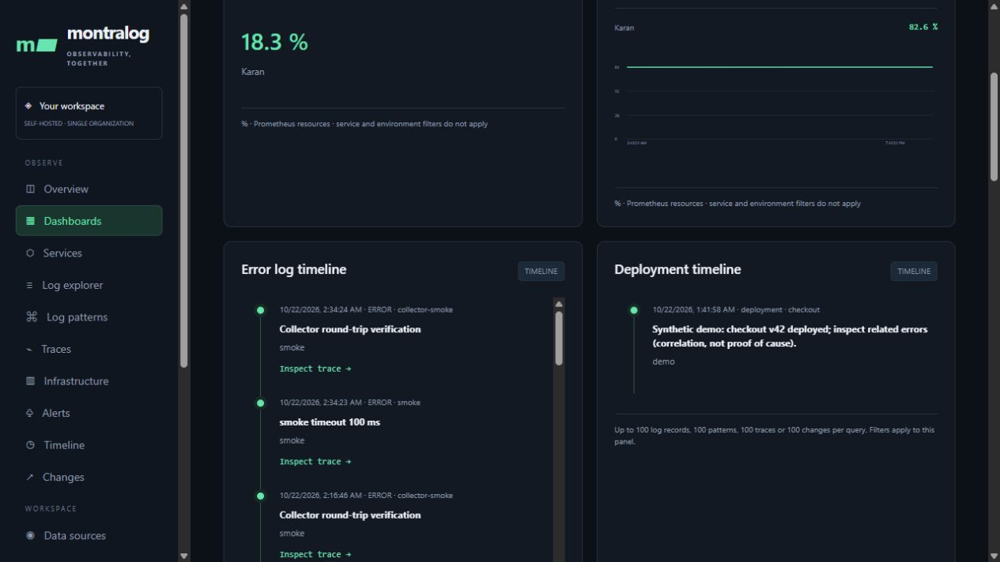
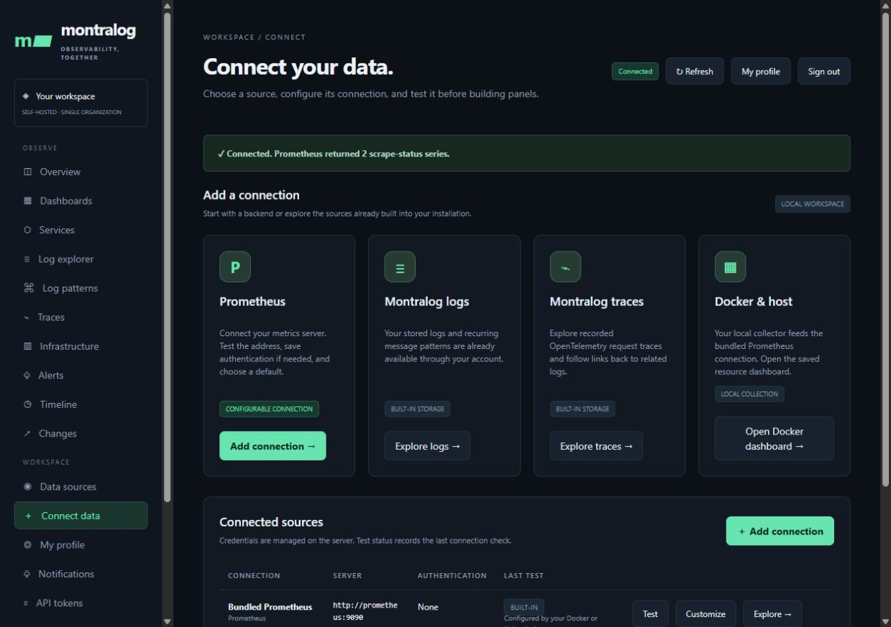
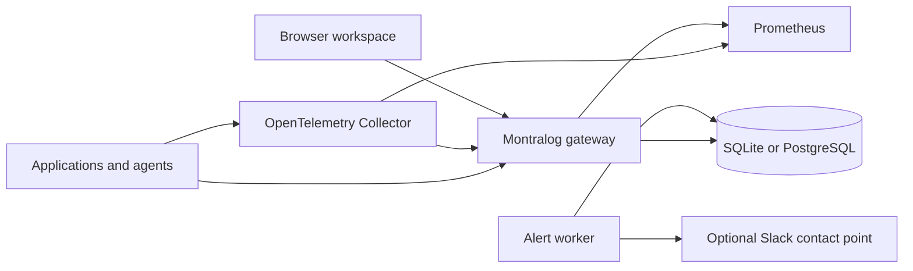

<p align="center"></p>

<h1 align="center">Montralog</h1>
<p align="center"><strong>Monitoring · Tracing · Logging · Tracking</strong><br>Self-hosted observability for understanding your systems.</p>
<p align="center"><a href="#see-montralog-in-action">Screenshots</a> · <a href="#quickstart">Quickstart</a> · <a href="docs/README.md">Documentation</a> · <a href="CONTRIBUTING.md">Contribute</a> · <a href="SECURITY.md">Security</a></p>

Montralog brings logs, traces, recurring log patterns, Prometheus metrics, dashboards and alerts into one workspace. Install and operate it with Docker Compose. First-party code is Apache-2.0; no hosted Montralog account is required.

**Current stable release: [0.6.0](https://github.com/montralog/montralog/releases/tag/v0.6.0) — Docker installation and isolated customer deployments.** See [published releases](https://github.com/montralog/montralog/releases), [security and test reports](docs/reports/README.md), and the [production acceptance matrix](docs/PRODUCTION.md). Use only a published version and its image digest for deployment.

## See Montralog in action

Local evaluation screenshots showing actual Montralog features. Timeline examples include synthetic demo/test events; these images are not production performance claims.

### Build a monitoring dashboard

Combine statistics, graphs and multiple timelines in a saved dashboard. Metric panels query your configured Prometheus source.



### Explore log and deployment timelines

Compare recorded errors and deployment changes side by side, then open a related trace. Correlation provides evidence to investigate; it is not proof of cause.




### Connect and test your data sources

Configure a Prometheus server, choose authentication when needed, and test its connection. Built-in log/trace storage and optional host/Docker collection are shown separately.




Try it yourself with the [quickstart](#quickstart), then follow the [organization rollout guide](docs/ORGANIZATION_ROLLOUT.md).

## What works today

| Area | Available |
|---|---|
| Logs and traces | JSON / OTLP JSON ingestion, log search, message-pattern grouping, trace timing and log-to-trace correlation |
| Metrics | Bundled Prometheus; saved Prometheus connections with optional authentication and connection tests |
| Dashboards | Personal saved dashboards; line, bar, statistic, table, log-pattern and timeline panels |
| Alerting | Metric/log rules, pending/firing state, in-app notifications and optional Slack webhooks with persisted retries |
| Access | Local accounts, revocable browser sessions, administrator/viewer roles, organizational teams and groups, expiring read/ingest tokens |
| Company login | Microsoft Entra ID, Google Workspace and Okta OIDC setup; requires your registration and live verification |
| Infrastructure | Optional host/Docker metrics agent; external exporters supply their respective metrics |
| Storage | SQLite application data by default, optional PostgreSQL; Prometheus stores metrics; persisted collector queues |

## Quickstart

Prerequisites: Docker Engine/Desktop using Linux containers and Docker Compose v2. Host Python, Helm and Kubernetes are not required. Download the release source ZIP or clone the repository:

```sh
git clone https://github.com/montralog/montralog.git
cd montralog
docker run --rm --user 0:0 --entrypoint python -v "${PWD}:/install" ghcr.io/montralog/montralog:0.6.0 /install/scripts/setup.py
docker compose pull
docker compose up -d --wait --wait-timeout 180
docker compose exec gateway python -m montralog create-user --username admin --name Administrator
```

Choose a unique password at the prompt. Fresh installations have no shared default account. Open **http://localhost:8080** and sign in. Browser access uses your session; you do not need to paste a read token into the UI.

`setup.py` creates private machine credentials in `.env` and preserves an existing file. Never commit this file or share your database. Docker services bind to loopback by default. Use HTTPS and secure cookies before exposing the application remotely.

Check startup with `docker compose ps` and open the workspace. Follow the [Docker guide](docs/CONTAINERS.md) for upgrades, backup and recovery. For multiple customers, use [separate customer stacks](docs/TENANCY.md); do not reuse credentials or volumes.

## Start exploring

1. Open **Connect data** and test the bundled Prometheus endpoint, `http://prometheus:9090`.
2. Run the optional demo, or instrument your application using the [API guide](docs/API.md).
3. Explore logs, patterns and traces, then create a dashboard and add panels.
4. Configure rules and notifications; Slack requires your own webhook and delivery test.
5. Open **People & access** for roles, teams, groups and company-login settings.

Use the [evaluation walkthrough](docs/EVALUATION.md) for a complete test session. Stop with `docker compose stop`; named volumes retain data. Do not run `docker compose down -v` against valuable data.

## Architecture



The gateway serves the browser UI and authenticated APIs. Application records and configuration live in SQLite/PostgreSQL; metric series live in Prometheus. PostgreSQL supports shared application storage, but does not make the entire stack highly available.

## Documentation

| Goal | Guide |
|---|---|
| Find documentation | [Documentation index](docs/README.md) |
| Connect Prometheus | [Connections](docs/CONNECTIONS.md) |
| Build dashboards, tokens and alerts | [Studio](docs/STUDIO.md) |
| Manage people and company login | [Identity](docs/IDENTITY.md), [accounts](docs/ACCOUNTS.md) |
| Send application data | [API](docs/API.md), [agents](agents/README.md) |
| Isolate customers | [Docker tenant isolation](docs/TENANCY.md) |
| Inspect published scans and load results | [Evidence index](docs/reports/README.md) |
| Back up, restore and operate | [Operations](docs/OPERATIONS.md), [storage](docs/STORAGE.md) |
| Evaluate readiness and test evidence | [Production checklist](docs/PRODUCTION.md), [verification](docs/VERIFICATION.md) |
| Understand source folders | [Project structure](docs/PROJECT_STRUCTURE.md), [architecture](docs/ARCHITECTURE.md) |

## Current boundaries

Teams/groups organize membership; they do not isolate telemetry or grant inherited permissions. There is no custom RBAC, SCIM, directory synchronization or automatic deprovisioning. Company-login tests use signed local tokens and mocked exchanges; no live tenant credentials were supplied during initial validation.

Microsoft 365, Google Workspace and Okta audit-event polling are not implemented. Company login does not collect audit logs. Other security tools can send supported log/OpenTelemetry data through your own collector or adapter.

Log grouping is heuristic, not proven root-cause analysis. Integration credentials support authenticated encryption with an operator-held key; existing plaintext records require the [explicit migration](docs/SECURITY-0.5.1.md). Slack delivery, backup restoration, load limits and Kubernetes behavior must be validated in your environment. The published Linux/amd64 container and versioned Helm chart use the same release. See [container installation](docs/CONTAINERS.md) and [support scope](docs/SUPPORT.md).

## Contribute

Issues and pull requests are welcome. Start with [CONTRIBUTING.md](CONTRIBUTING.md), include reproducible steps, and sanitize telemetry and credentials. See the maintained release line and compatibility scope in [the support policy](docs/SUPPORT.md).

```sh
python -m pip install -e ".[server]" -r requirements-dev.txt
python -m unittest discover -s tests -v
```

PostgreSQL tests are opt-in and require a separate disposable database named `montralog_test`. They clear test records: never supply production credentials. See the CI workflow for JavaScript, container and Helm checks.

## License and security

First-party code is licensed under [Apache-2.0](LICENSE). Dependencies retain their own licenses; see [NOTICE](NOTICE) and [third-party components](docs/THIRD_PARTY.md). Report vulnerabilities privately through [GitHub Security Advisories](https://github.com/montralog/montralog/security/advisories/new), rather than public issues. See [SECURITY.md](SECURITY.md) for scope and limitations.
