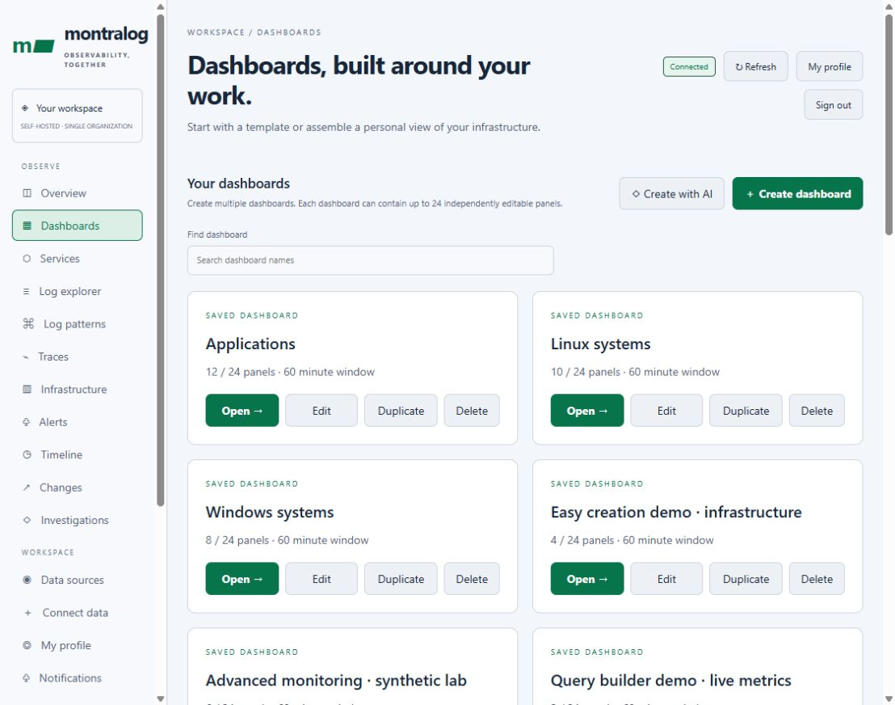
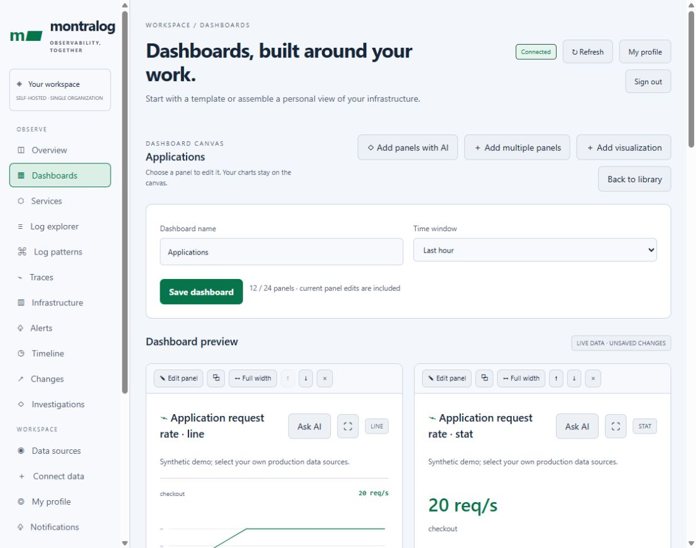
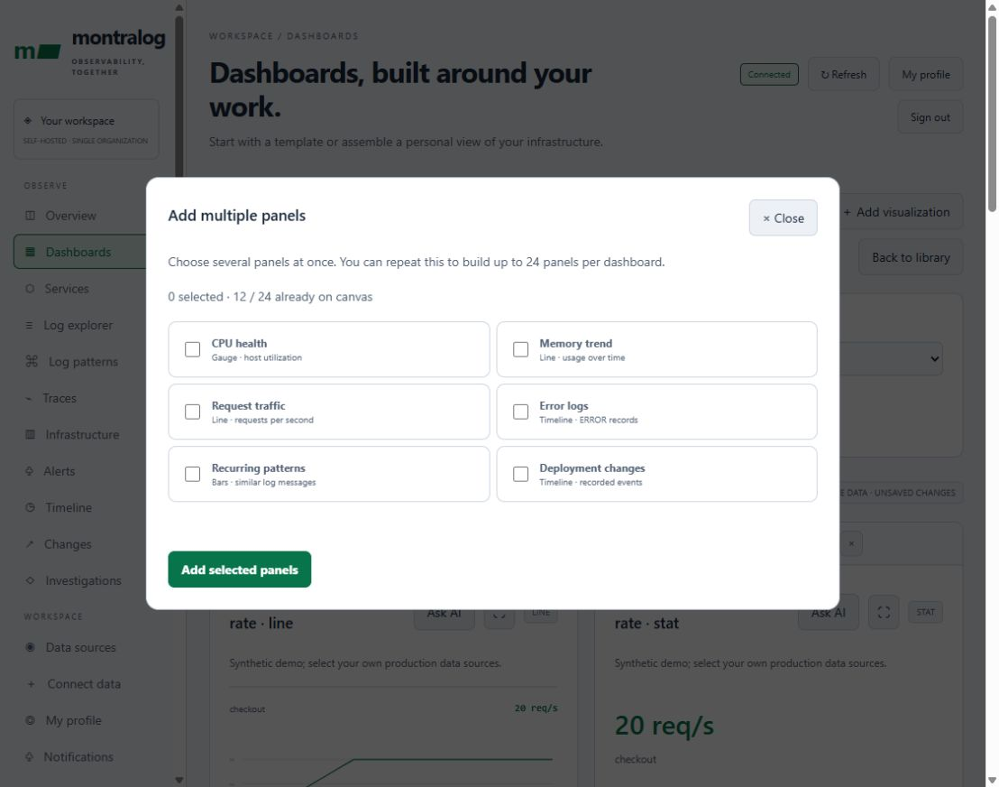
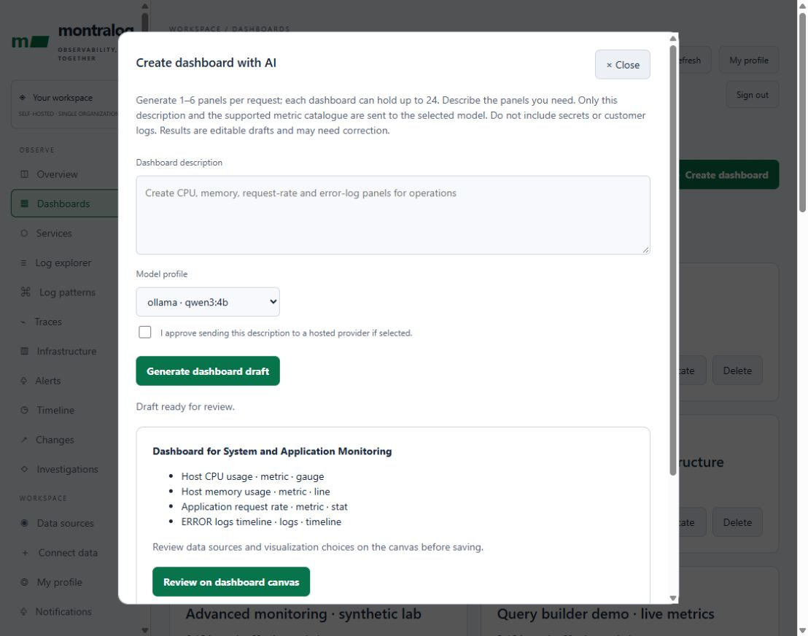
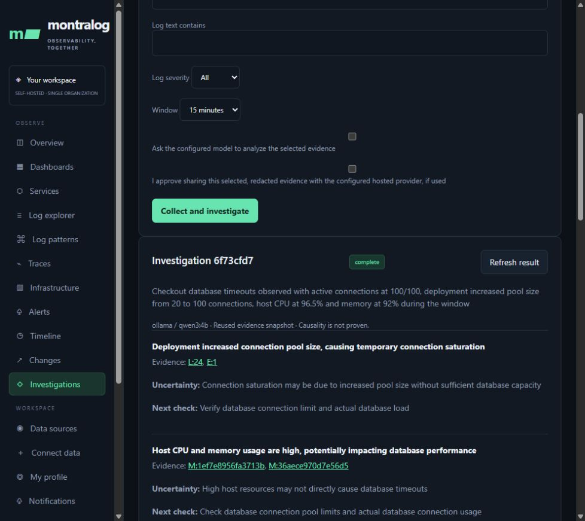
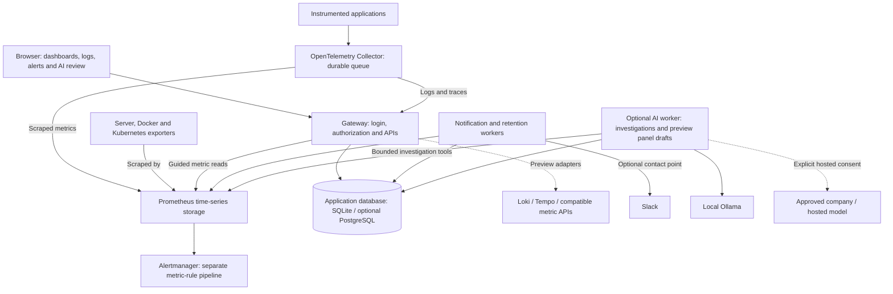

<p align="center"></p>
<h1 align="center">Montralog</h1>
<p align="center"><strong>Monitoring · Tracing · Logging · Tracking</strong><br>Your telemetry, dashboards and evidence in one self-hosted workspace.</p>
<p align="center"><a href="#quickstart-docker">Install with Docker</a> · <a href="#dashboards-in-action">Screenshots</a> · <a href="#architecture">Architecture</a> · <a href="#configure-your-ai-model">Configure AI</a> · <a href="docs/README.md">Documentation</a></p>

Montralog combines Prometheus metrics, logs, trace summaries, deployment events and alerts. Build dashboards for your systems and applications, investigate incidents with linked evidence, and optionally connect your own approved AI model. Run the stack on your infrastructure; no hosted Montralog account is required. First-party code is **Apache-2.0**.

## Release status

**Published release: [0.8.0](https://github.com/montralog/montralog/releases/tag/v0.8.0).** The Docker quickstart below installs that version. [Release evidence](docs/reports/0.8.0/README.md).

**Dashboard development preview:** this branch adds the card library, Windows/Linux starters, multi-panel selection, AI panel drafts, Settings appearance and external backend adapters shown below. These updates are tracked in [PR #10](https://github.com/montralog/montralog/pull/10); the published `0.8.0` image does not include all preview features. [Preview verification](docs/reports/dashboard-creation/README.md).

## What you can build

| Workflow | What Montralog provides |
|---|---|
| Observe services | Search logs, group repeated messages, inspect traces and correlate deployment events |
| Create personal dashboards | Saved panels and timelines; preview adds dashboard cards, guided queries, gauges, presets and up to 24 panels per dashboard |
| Connect telemetry | Bundled Prometheus and local records; preview adds Loki, Tempo and Prometheus-compatible backend choices |
| Investigate incidents | Optional bounded, read-only AI analysis with observed evidence, uncertainty and runbook checks |
| Create panels with AI — preview | Ask an approved model for 1–6 validated panel proposals, review them and save explicitly |
| Alert and notify | Metric/log rules, pending/firing states, in-app notifications and optional Slack contact points with persisted retries |
| Manage access | Local login, admin/viewer roles, teams/groups, revocable sessions and expiring read/ingest tokens |
| Use company sign-in | Entra ID, Google Workspace and Okta OIDC configuration; your registration and live validation are required |
| Separate customers | A dedicated Docker stack, database, volumes, credentials and encryption key for each customer |

<a id="see-it-in-action"></a>
<a id="see-montralog-in-action"></a>

## Dashboards in action

Actual application captures from the dashboard development preview, refreshed on **1 November 2026**. Data is synthetic; the cards do not imply discovery of physical Windows/Linux machines. Missing telemetry remains an empty state. [Screenshot details](docs/assets/screenshots/README.md).

### One dashboard for each area of work

Create Windows, Linux and Application dashboards with their own panel lists. Search, open, edit or duplicate a saved dashboard. Starter counts are starting points: each dashboard supports **0–24 panels**.



### Edit panels on a visual canvas

Open a dashboard and choose **Edit**, or use an individual panel's edit action. Add visualizations, choose supported metrics and aggregations, inspect the generated query, and preview real data. Resize, reorder, duplicate or expand panels, then choose **Save dashboard**.



### Add several panels together

Choose **Add multiple panels**, select presets and review the combined count. Use it repeatedly to grow a dashboard beyond its starter panels. Themes are configured separately under **Settings → Appearance**.



### Review AI-generated panels before saving

Administrators can choose **Create with AI** or **Add panels with AI**. The model receives the description and supported metric catalogue, not telemetry or credentials. Validated proposals open as an editable draft. Check data sources, titles, thresholds and filters yourself: a title mentioning ERROR does not establish an ERROR severity filter.



[Dashboard walkthrough and limits](docs/STUDIO.md) · [AI setup](#configure-your-ai-model) · [Real Ollama verification](docs/reports/dashboard-creation/ollama-panel-draft.json).

### Investigate with evidence

Choose **Ask AI** on a supported local panel, or **Investigate** on an alert. The investigation captures a bounded time window, follows the saved runbook and can request approved metric reads. Results retain evidence references, missing measurements and recommended checks. Hypotheses remain unverified until you validate them.



## Supported data sources

| Source | Supported use | Availability |
|---|---|---|
| Prometheus | Guided metric queries and connection testing | Released |
| Montralog storage | Logs, patterns, traces and deployment events | Released |
| VictoriaMetrics, Mimir, Thanos | Supported metrics through their Prometheus-compatible query API | Preview |
| Loki | Sampled log tables, timelines and recurring patterns | Preview |
| Tempo | Trace search summaries and timelines | Preview |

Use **Connect data** to select a backend, configure its query URL and optional authentication, test, then save. Private endpoints need operator destination allowlisting; credentials require HTTPS. The preview does not implement arbitrary SQL, Elasticsearch, Splunk, Datadog, cloud OAuth or custom tenant headers. [Connection setup](docs/CONNECTIONS.md) · [Adapter behavior and limits](docs/STUDIO.md#external-backend-adapters).

<a id="quickstart"></a>

## Quickstart: Docker

Requires Docker Engine/Desktop with **Linux containers**, Docker Compose v2 and Git (or download the release source archive). Published application images support **Linux/amd64**. Host Python, Helm and Kubernetes are not required.

From PowerShell or a POSIX shell:

```sh
git clone --branch v0.8.0 --depth 1 https://github.com/montralog/montralog.git
cd montralog

docker run --rm --user 0:0 --entrypoint python -v "${PWD}:/install" ghcr.io/montralog/montralog:0.8.0 /install/scripts/setup.py
docker compose pull
docker compose up -d --wait --wait-timeout 180
docker compose exec gateway python -m montralog create-user --username admin --name Administrator
```

Choose a unique password at the prompt. Fresh installations have **no shared default password**. Open **http://localhost:8080** and sign in; browser access uses the login session and does not require pasting a read token.

Setup creates a private `.env` with unique machine tokens, customer identity and encryption key, preserving an existing file. Protect it with operating-system permissions and never commit it. Services bind to loopback by default; configure HTTPS, secure cookies and restricted ingress before remote access. For reproducible deployments, pin the image digest from the release's `IMAGE_DIGESTS.txt`.

1. Open **Connect data** and test the bundled Prometheus endpoint, `http://prometheus:9090`.
2. Instrument an application or send supported telemetry using the [API guide](docs/API.md). Prometheus needs exporter targets for your infrastructure; installing Montralog does not discover every service automatically.
3. Explore logs, patterns and traces, then create a dashboard and panels.
4. Save an alert with a diagnostic runbook. Configure and test your Slack contact point if required.
5. Enable optional AI below, then choose **Ask AI** or **Investigate**.

Use `docker compose ps` to check services. `docker compose stop` retains named volumes. See the [Docker guide](docs/CONTAINERS.md) for backup, upgrade and restore, and [customer isolation](docs/TENANCY.md) before hosting multiple customers. Existing installations must preserve their identity, tokens and encryption key; do not replace a live configuration with fresh setup values.

## Architecture



The gateway serves the UI and authenticated APIs. The application database stores accounts, dashboard definitions, local telemetry, alert state and AI jobs. **Prometheus stores metric time series**; dashboard settings do not require PostgreSQL. External Loki/Tempo reads are not imported into the local database.

AI jobs run outside browser requests. Panel generation proposes configuration; investigations collect and analyze evidence. Neither automatically remediates infrastructure. Notification workers evaluate Montralog rules and persist delivery attempts; Alertmanager has a separate rule/delivery configuration.

Each customer runs a separate stack. Within that stack, gateway and workers share its database. Customers must not share database volumes, tokens or encryption keys. SQLite supports a single-node deployment; switching to PostgreSQL alone does not provide end-to-end high availability. [Architecture](docs/ARCHITECTURE.md) · [Storage](docs/STORAGE.md) · [Customer isolation](docs/TENANCY.md).

## Configure your AI model

AI is optional. Administrators can collect evidence without it. Model endpoints and keys are configured privately by the operator; users select approved models in the UI.

### Option 1: local Ollama

After the base Docker setup, use the optional AI Compose file:

```sh
docker compose -f compose.yaml -f deploy/docker/compose.ai.yaml pull
docker compose -f compose.yaml -f deploy/docker/compose.ai.yaml up -d --wait --wait-timeout 180
docker compose -f compose.yaml -f deploy/docker/compose.ai.yaml exec ollama ollama pull qwen3:4b
```

Keep **both `-f` arguments** for subsequent AI-stack operations. This adds the investigation worker and Ollama on the private Docker network; Ollama has no host port. Weights are downloaded explicitly into a persistent model volume. Allow roughly **6 GB free memory for the model plus the monitoring stack** and approximately **2.5 GB** for Qwen3 4B weights. CPU inference can take minutes; model licenses apply separately.

To use another Ollama model, download its weights and set `MONTRALOG_AI_MODEL` to that model ID in your private `.env`. Evaluate its structured responses before adoption.

### Option 2: your approved hosted or company endpoint

Set these values in the private `.env` for an OpenAI-compatible endpoint:

```dotenv
MONTRALOG_AI_PROVIDER=openai-compatible
MONTRALOG_AI_MODEL=your-approved-model-id
MONTRALOG_AI_URL=https://models.example.com/v1
MONTRALOG_AI_API_KEY=REPLACE_PRIVATELY
MONTRALOG_AI_LOCAL_HTTP=false
MONTRALOG_AI_EGRESS=true
```

`models.example.com` and the model ID are placeholders. Use the endpoint base URL and credentials approved by your organization. The adapter appends `/chat/completions`; do not include that suffix in the base URL.

| Provider setting | API adapter | Base URL |
|---|---|---|
| `ollama` | Local chat | `http://ollama:11434` |
| `openai` | Responses | `https://api.openai.com/v1` |
| `openai-compatible` | Chat completions | Your approved compatible API base |
| `anthropic` | Messages | `https://api.anthropic.com/v1` |
| `gemini` | generateContent | `https://generativelanguage.googleapis.com/v1beta` |

Use the same private model settings for gateway and worker. Apply changes with the two-file Compose `up -d` command above. HTTPS is required for hosted endpoints. A private company endpoint also needs its exact `hostname:port` in `MONTRALOG_ALLOWED_DESTINATIONS`; metadata/link-local destinations remain prohibited. Hosted model access and output compatibility require your own live validation.

### Offer several approved models

Add private profile definitions and keys to `.env`:

```dotenv
MONTRALOG_AI_PROFILES='{"local":{"provider":"ollama","model":"qwen3:4b","url":"http://ollama:11434","local_http":true},"company":{"provider":"openai-compatible","model":"your-approved-model-id","url":"https://models.example.com/v1","key_env":"COMPANY_AI_KEY"}}'
MONTRALOG_AI_PROFILE_KEYS='{"COMPANY_AI_KEY":"REPLACE_PRIVATELY"}'
MONTRALOG_AI_EGRESS=true
```

The AI Compose file passes these values to both services. After applying the configuration, **Approved model** lists the profile IDs. Keys stay server-side and never appear in browser configuration. For a completely local deployment, leave hosted egress disabled. Hosted analysis requires both operator-enabled egress and explicit per-investigation sharing approval; review the selected redacted telemetry before consenting.

### Create dashboards with AI — development preview

After configuring the provider and running the AI worker on a preview build, sign in as an administrator. Open **Dashboards → Create with AI**, select an approved model and describe the signals you want. For example: “Create CPU health, memory trend and application request-rate panels.” Reopen queued results under **Recent drafts**. Review the proposed panels on the canvas, select sources and filters, then save. **Add panels with AI** appends to an existing draft without changing its name or saving automatically.

A request proposes **1–6 panels**, while a dashboard holds **up to 24**. Only supported signals and views are accepted; arbitrary queries, URLs and executable settings are rejected. Hosted requests require explicit sharing approval in addition to operator-enabled egress. [Full dashboard guide](docs/STUDIO.md#ai-assisted-dashboard-drafts).

The published 0.8.0 AI Compose file configures investigations. It does not upgrade the image to the dashboard preview. Do not mix a preview gateway with older workers; schema-8 rollback requires the pre-upgrade database backup and matching encryption key.

### How an investigation works

1. Select the model, saved metric source, time window and question, optionally linked to an alert/runbook.
2. Capture selected logs, repeated patterns, failed spans and changes. Alert scope takes precedence over conflicting form filters.
3. Read the initial metric. The model may choose up to two additional snapshot/trend tools from the built-in catalog, within **three total model calls**.
4. Validate evidence IDs and literal excerpts, then show hypotheses, uncertainty, missing evidence and read-only next checks. Use **Refresh result** to retrieve asynchronous progress.

The agent cannot choose arbitrary URLs, PromQL, credentials or shell commands. It does not run infrastructure remediation or investigate every alert automatically. Connected sources are used directly; a general-purpose MCP client is not implemented. A separately reviewed and explicitly approved data-source recheck is the only implemented diagnostic action.

The optional AI Compose configuration defaults to **20 submissions/day** and **300,000 reserved units/day** per customer. One maximum agent investigation reserves **94,500 units** for its three-call bound. Reservations count prompt bytes plus output allowances, are retained on failure and are not monetary prices. Set `MONTRALOG_AI_DAILY_REQUESTS` and `MONTRALOG_AI_DAILY_TOKEN_BUDGET` to your approved limits. See [complete AI configuration and limits](docs/AI-INVESTIGATIONS.md).

## Operate and verify

Before allowing remote access, configure HTTPS and secure cookies, restrict ingress, test backup/restore with the encryption key, and validate capacity for your workload. Preserve the `.env`, database and matching key during upgrades. Use separate backups and credentials per customer.

The verification pipeline covers Python 3.11/3.13, browser workflows, containers, security scanning, resilience, Helm compatibility and local-model inference. Reports describe a specific revision and workload; clean scans and short synthetic tests do not certify production security or sustained capacity.

- [Dashboard preview checks and dependency audit](docs/reports/dashboard-creation/README.md)
- [Published 0.8.0 evidence and review limits](docs/reports/0.8.0/README.md)
- [Production acceptance matrix](docs/PRODUCTION.md)
- [Backup, encrypted secrets and recovery](docs/ASSURANCE.md)
- [Organization rollout](docs/ORGANIZATION_ROLLOUT.md)

## Documentation

| Start here | Guide |
|---|---|
| Install and upgrade | [Docker setup, backup and restore](docs/CONTAINERS.md) |
| Build dashboards | [Cards, panels, queries, themes and AI drafts](docs/STUDIO.md) |
| Configure models | [AI investigations and provider settings](docs/AI-INVESTIGATIONS.md) |
| Connect and ingest | [Connections](docs/CONNECTIONS.md), [API](docs/API.md), [agents](agents/README.md) |
| Manage users | [Accounts](docs/ACCOUNTS.md), [teams and OIDC](docs/IDENTITY.md) |
| Host separate customers | [Isolation](docs/TENANCY.md), [assurance](docs/ASSURANCE.md) |
| Assess the project | [Public reports](docs/reports/README.md), [testing](docs/TESTING.md), [support scope](docs/SUPPORT.md) |
| Understand the code | [Architecture](docs/ARCHITECTURE.md), [project structure](docs/PROJECT_STRUCTURE.md) |
| Browse all guides | [Documentation index](docs/README.md) |

## Current boundaries

Teams/groups organize membership; they do not isolate telemetry or implement custom RBAC, SCIM or automatic deprovisioning. OIDC sign-in does not collect Microsoft 365, Google Workspace or Okta audit events. Connect exporters and instrument services explicitly; Montralog does not discover every system automatically.

AI provides evidence-linked hypotheses and advice. Citations establish provenance, not causal truth; redaction is heuristic. Arbitrary MCP servers, automatic infrastructure remediation and AI analysis of external Loki/Tempo records are not implemented. Validate live SSO, hosted model compatibility, Slack receipt, restore and load in your environment.

Docker Compose is the supported installation path. Versioned Helm artifacts remain available for compatibility. [Support scope](docs/SUPPORT.md).

## Contribute

Issues and pull requests are welcome. Include reproducible steps and sanitize telemetry and credentials. See [CONTRIBUTING.md](CONTRIBUTING.md).

```sh
python -m pip install -e ".[server]" -r requirements-dev.txt
python -m unittest discover -s tests -v
```

PostgreSQL tests require a **disposable** database named `montralog_test`; they clear test records. Use the [testing guide](docs/TESTING.md) for browser, container and optional database checks.

## License and security reporting

First-party code is [Apache-2.0](LICENSE). [Branding and attribution](BRANDING.md) describe project identity without adding restrictions to that license. The application includes **About & license**; dependencies and model weights retain their own terms. See [NOTICE](NOTICE) and [third-party components](docs/THIRD_PARTY.md).

Report vulnerabilities privately through [GitHub Security Advisories](https://github.com/montralog/montralog/security/advisories/new). [Security policy](SECURITY.md).
