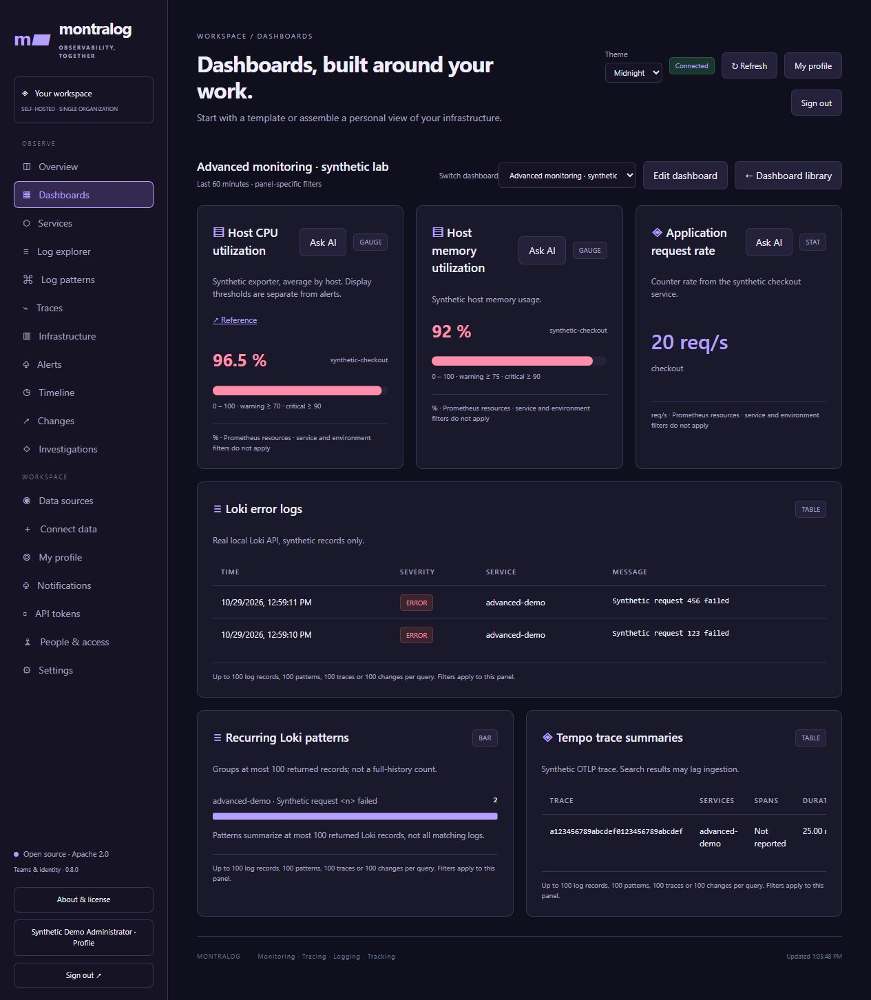
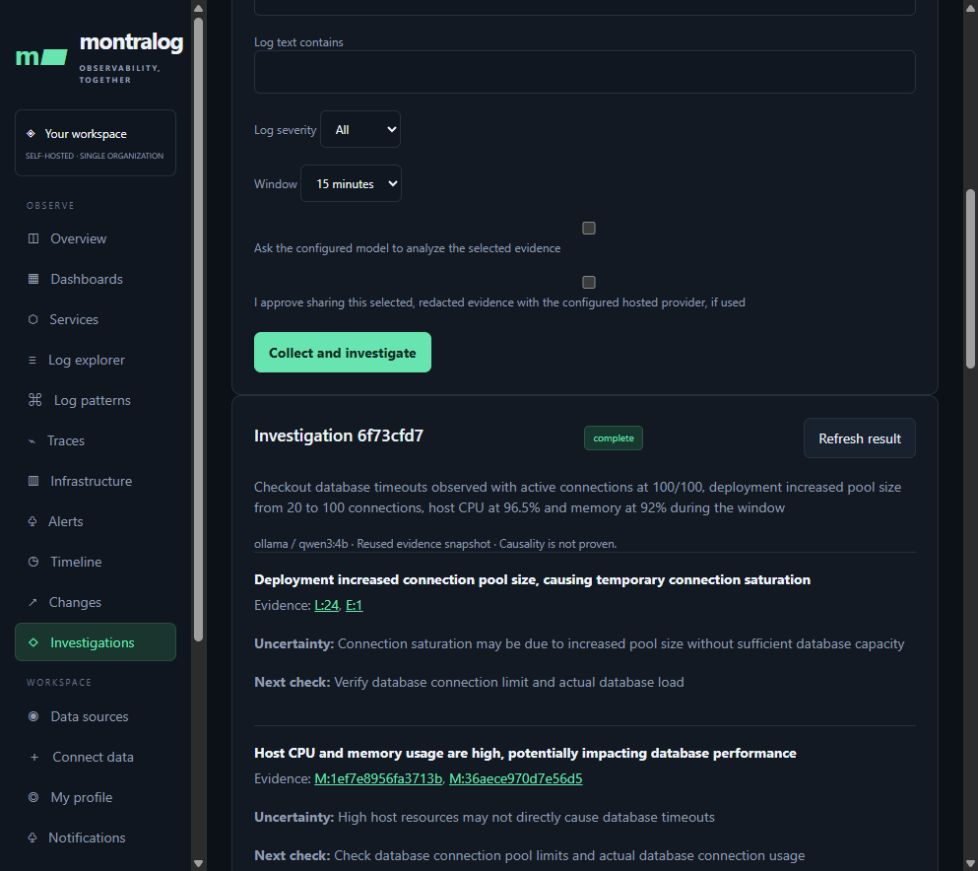
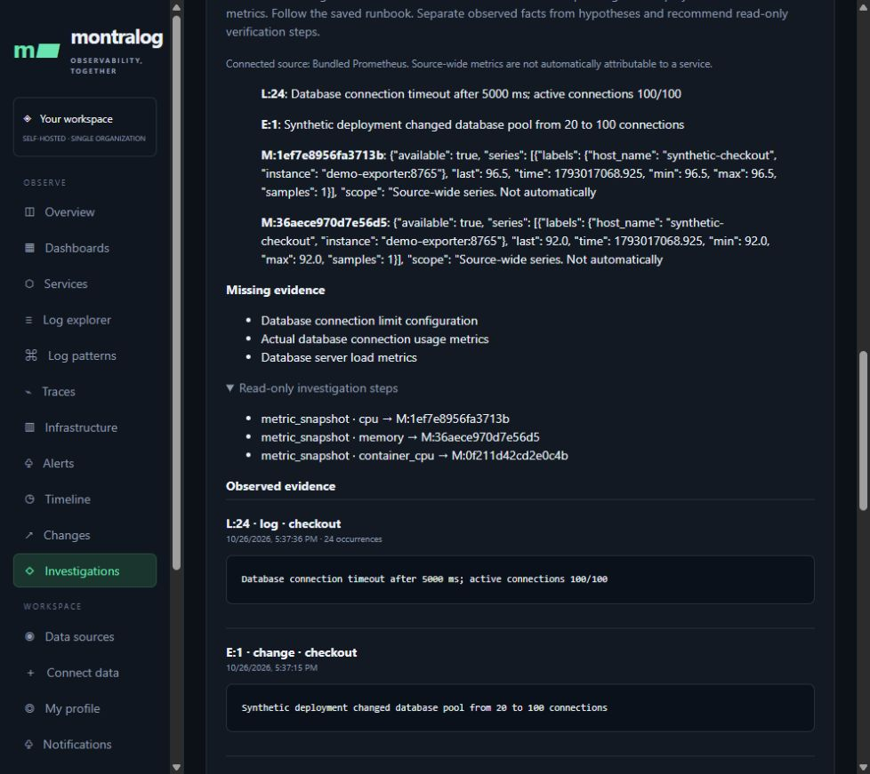
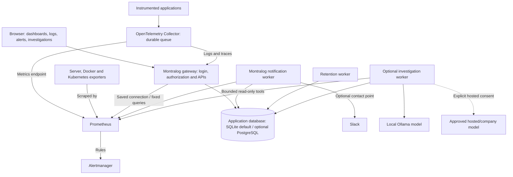

<p align="center"></p>
<h1 align="center">Montralog</h1>
<p align="center"><strong>Monitoring · Tracing · Logging · Tracking</strong><br>Self-hosted observability with evidence-first AI investigations.</p>
<p align="center"><a href="#see-it-in-action">Screenshots</a> · <a href="#quickstart-docker">Install</a> · <a href="#architecture">Architecture</a> · <a href="#configure-your-ai-model">AI setup</a> · <a href="docs/README.md">Documentation</a> · <a href="CONTRIBUTING.md">Contribute</a></p>

Montralog brings logs, traces, Prometheus metrics, dashboards, deployment timelines and alerts into one workspace. Start without AI, or connect an operator-approved model to investigate captured evidence and recommend checks. Run it on your own infrastructure with Docker Compose. First-party code is Apache-2.0; no hosted Montralog account is required.

**Version 0.8.0** introduces a bounded, read-only investigation agent, dashboard assistance, alert runbooks and selectable model profiles. [Release and downloads](https://github.com/montralog/montralog/releases/tag/v0.8.0) · [Release verification](https://github.com/montralog/montralog/actions/runs/40376265345) · [Public evidence](docs/reports/0.8.0/README.md).

## What you can do

| Capability | Available in Montralog |
|---|---|
| Explore telemetry | Search logs, group recurring patterns, inspect spans and connect logs to traces |
| Build dashboards | Saved line, bar, statistic, table, pattern and timeline panels |
| Connect metrics | Bundled Prometheus or saved Prometheus connections with optional authentication |
| Investigate incidents | Compare logs, failed spans, deployment changes and bounded metric reads with an optional model |
| Guide the agent | Save alert context, up to eight runbook checks and recovery criteria; choose an approved model |
| Alert and notify | Log/metric rules, pending/firing state, in-app notifications and optional Slack webhooks with persisted retries |
| Manage access | Local accounts, revocable sessions, admin/viewer roles, teams/groups and expiring read/ingest tokens |
| Use company login | Entra ID, Google Workspace and Okta OIDC configuration; requires your registration and live validation |
| Monitor infrastructure | Instrument applications and connect exporters for servers, Docker and Kubernetes; optional host/Docker agent |
| Operate customer stacks | Separate database, credentials, encryption key, network and volumes per customer |

## See it in action

These are actual application screenshots. The AI example uses synthetic telemetry and a real local Qwen3 4B model; it is not a production incident or a root-cause accuracy benchmark.

### Advanced dashboard development preview

Gauge thresholds, panel icons and references, flexible widths, Loki log patterns
and Tempo trace summaries are available on the dashboard development branch.
[Capabilities and setup](docs/STUDIO.md) · [Test evidence and limits](docs/reports/dashboard-connectors/README.md).



### Dashboards and timelines

Combine resource graphs, log activity and deployment events in a saved dashboard. The development dashboard builder adds guided metric aggregation with generated queries, dashboard search/duplication/switching, Dark, Light, Midnight or System appearance, gauge thresholds, contextual references, and flexible panel sizes. The development connector catalogue adds Loki logs/patterns, Tempo trace summaries, and Prometheus-compatible backend types. See the [dashboard guide](docs/STUDIO.md) for configuration.


### Connected data sources

Save a Prometheus connection, configure authentication when needed and test connectivity before using its metrics.


### AI investigation with evidence

From a panel choose **Ask AI**, or from an alert choose **Investigate**. The agent captures the selected window, considers the saved runbook and inspects approved metrics. Results link to observed records and state uncertainty and verification steps.



In this demo, timeout logs reported **100/100 connections**, a deployment changed the pool from **20 to 100**, and resource samples showed **96.5% CPU / 92% memory**. The agent inspected CPU, then requested memory and container CPU. It identified missing database limits and load measurements; the application retained the result as an **unverified hypothesis**.



## Quickstart: Docker

Requires Docker Engine/Desktop with **Linux containers**, Docker Compose v2 and Git (or download the release source archive). Published application images support **Linux/amd64**. Host Python, Helm and Kubernetes are not required.

From PowerShell or a POSIX shell:

```sh
git clone --branch v0.8.0 --depth 1 https://github.com/montralog/montralog.git
cd montralog

docker run --rm --user 0:0 --entrypoint python -v "${PWD}:/install" ghcr.io/montralog/montralog:0.8.0 /install/scripts/setup.py
docker compose pull
docker compose up -d --wait --wait-timeout 180
docker compose exec gateway python -m montralog create-user --username admin --name Administrator
```

Choose a unique password at the prompt. Fresh installations have **no shared default password**. Open **http://localhost:8080** and sign in; browser access uses the login session and does not require pasting a read token.

Setup creates a private `.env` with unique machine tokens, customer identity and encryption key, preserving an existing file. Protect it with operating-system permissions and never commit it. Services bind to loopback by default; configure HTTPS, secure cookies and restricted ingress before remote access. For reproducible deployments, pin the image digest from the release's `IMAGE_DIGESTS.txt`.

1. Open **Connect data** and test the bundled Prometheus endpoint, `http://prometheus:9090`.
2. Instrument an application or send supported telemetry using the [API guide](docs/API.md). Prometheus needs exporter targets for your infrastructure; installing Montralog does not discover every service automatically.
3. Explore logs, patterns and traces, then create a dashboard and panels.
4. Save an alert with a diagnostic runbook. Configure and test your Slack contact point if required.
5. Enable optional AI below, then choose **Ask AI** or **Investigate**.

Use `docker compose ps` to check services. `docker compose stop` retains named volumes. See the [Docker guide](docs/CONTAINERS.md) for backup, upgrade and restore, and [customer isolation](docs/TENANCY.md) before hosting multiple customers. Existing installations must preserve their identity, tokens and encryption key; do not replace a live configuration with fresh setup values.

## Architecture



The gateway serves the UI and authenticated APIs. The application database holds telemetry records, accounts, dashboards, alert state and investigations. Prometheus stores metric time series. The notification worker evaluates Montralog rules and persists delivery retries; Prometheus/Alertmanager have their own metric-rule pipeline. The optional investigation worker processes queued analyses independently of browser requests.

Each customer runs a separate stack. Within that stack, gateway and workers share its application database. Customers must not share database volumes, tokens or encryption keys. SQLite is a single-node option; optional PostgreSQL does not make the entire stack highly available. See the [architecture guide](docs/ARCHITECTURE.md) and [storage guide](docs/STORAGE.md).

## Configure your AI model

AI is optional. Administrators can collect evidence without it. Model endpoints and keys are configured privately by the operator; users select approved models in the UI.

### Option 1: local Ollama

After the base Docker setup, use the optional AI Compose file:

```sh
docker compose -f compose.yaml -f deploy/docker/compose.ai.yaml pull
docker compose -f compose.yaml -f deploy/docker/compose.ai.yaml up -d --wait --wait-timeout 180
docker compose -f compose.yaml -f deploy/docker/compose.ai.yaml exec ollama ollama pull qwen3:4b
```

Keep **both `-f` arguments** for subsequent AI-stack operations. This adds the investigation worker and Ollama on the private Docker network; Ollama has no host port. Weights are downloaded explicitly into a persistent model volume. Allow roughly **6 GB free memory for the model plus the monitoring stack** and approximately **2.5 GB** for Qwen3 4B weights. CPU inference can take minutes; model licenses apply separately.

To use another Ollama model, download its weights and set `MONTRALOG_AI_MODEL` to that model ID in your private `.env`. Evaluate its structured responses before adoption.

### Option 2: your approved hosted or company endpoint

Set these values in the private `.env` for an OpenAI-compatible endpoint:

```dotenv
MONTRALOG_AI_PROVIDER=openai-compatible
MONTRALOG_AI_MODEL=your-approved-model-id
MONTRALOG_AI_URL=https://models.example.com/v1
MONTRALOG_AI_API_KEY=REPLACE_PRIVATELY
MONTRALOG_AI_LOCAL_HTTP=false
MONTRALOG_AI_EGRESS=true
```

`models.example.com` and the model ID are placeholders. Use the endpoint base URL and credentials approved by your organization. The adapter appends `/chat/completions`; do not include that suffix in the base URL.

| Provider setting | API adapter | Base URL |
|---|---|---|
| `ollama` | Local chat | `http://ollama:11434` |
| `openai` | Responses | `https://api.openai.com/v1` |
| `openai-compatible` | Chat completions | Your approved compatible API base |
| `anthropic` | Messages | `https://api.anthropic.com/v1` |
| `gemini` | generateContent | `https://generativelanguage.googleapis.com/v1beta` |

Use the same private model settings for gateway and worker. Apply changes with the two-file Compose `up -d` command above. HTTPS is required for hosted endpoints. A private company endpoint also needs its exact `hostname:port` in `MONTRALOG_ALLOWED_DESTINATIONS`; metadata/link-local destinations remain prohibited. Hosted model access and output compatibility require your own live validation.

### Offer several approved models

Add private profile definitions and keys to `.env`:

```dotenv
MONTRALOG_AI_PROFILES='{"local":{"provider":"ollama","model":"qwen3:4b","url":"http://ollama:11434","local_http":true},"company":{"provider":"openai-compatible","model":"your-approved-model-id","url":"https://models.example.com/v1","key_env":"COMPANY_AI_KEY"}}'
MONTRALOG_AI_PROFILE_KEYS='{"COMPANY_AI_KEY":"REPLACE_PRIVATELY"}'
MONTRALOG_AI_EGRESS=true
```

The AI Compose file passes these values to both services. After applying the configuration, **Approved model** lists the profile IDs. Keys stay server-side and never appear in browser configuration. For a completely local deployment, leave hosted egress disabled. Hosted analysis requires both operator-enabled egress and explicit per-investigation sharing approval; review the selected redacted telemetry before consenting.

### How an investigation works

1. Select the model, saved metric source, time window and question, optionally linked to an alert/runbook.
2. Capture selected logs, repeated patterns, failed spans and changes. Alert scope takes precedence over conflicting form filters.
3. Read the initial metric. The model may choose up to two additional snapshot/trend tools from the built-in catalog, within **three total model calls**.
4. Validate evidence IDs and literal excerpts, then show hypotheses, uncertainty, missing evidence and read-only next checks. Use **Refresh result** to retrieve asynchronous progress.

The agent cannot choose arbitrary URLs, PromQL, credentials or shell commands. It does not run infrastructure remediation or investigate every alert automatically. Connected sources are used directly; a general-purpose MCP client is not implemented. A separately reviewed and explicitly approved data-source recheck is the only implemented diagnostic action.

The optional AI Compose configuration defaults to **20 submissions/day** and **300,000 reserved units/day** per customer. One maximum agent investigation reserves **94,500 units** for its three-call bound. Reservations count prompt bytes plus output allowances, are retained on failure and are not monetary prices. Set `MONTRALOG_AI_DAILY_REQUESTS` and `MONTRALOG_AI_DAILY_TOKEN_BUDGET` to your approved limits. See [complete AI configuration and limits](docs/AI-INVESTIGATIONS.md).

## Security, reliability and release evidence

The release pipeline verifies application tests on Python 3.11/3.13, Chromium workflows, container setup, Helm deployment, resilience and real local-model inference. It scans the image and dependencies, retains static findings, repeats bootstrap/load/recovery checks on the exact scanned image, then publishes that image with its digest, provenance and checksums.

[0.8.0 reports](docs/reports/0.8.0/README.md) include the measured workload and limitations. Clean automated scans are not proof that an application is secure. The new agent's [separate review was partial](docs/reports/0.8.0/review.md); no external professional penetration-test certification is claimed. Follow the [production acceptance matrix](docs/PRODUCTION.md), [backup and secret recovery guide](docs/ASSURANCE.md), and [rollout guide](docs/ORGANIZATION_ROLLOUT.md) for your environment.

## Documentation

| Goal | Guide |
|---|---|
| Install, upgrade and restore | [Docker](docs/CONTAINERS.md), [operations](docs/OPERATIONS.md) |
| Configure AI and read its results | [AI investigations](docs/AI-INVESTIGATIONS.md) |
| Connect services and metrics | [Connections](docs/CONNECTIONS.md), [API](docs/API.md), [agents](agents/README.md) |
| Create dashboards and alert runbooks | [Studio](docs/STUDIO.md) |
| Manage accounts and company login | [Accounts](docs/ACCOUNTS.md), [identity](docs/IDENTITY.md) |
| Separate customer deployments | [Tenant isolation](docs/TENANCY.md), [assurance](docs/ASSURANCE.md) |
| Inspect scans, tests and measurements | [Public reports](docs/reports/README.md), [production acceptance](docs/PRODUCTION.md) |
| Understand the code | [Architecture](docs/ARCHITECTURE.md), [project structure](docs/PROJECT_STRUCTURE.md) |
| Find all guides | [Documentation index](docs/README.md) |

## Current boundaries

Teams/groups organize membership; they do not provide telemetry isolation, custom RBAC, SCIM or automatic deprovisioning. Company login does not collect Microsoft 365, Google Workspace or Okta audit events; audit-event polling is not implemented. Other tools can send supported telemetry through your collector or adapter.

AI citations establish provenance, not causal truth. Redaction is heuristic; source-wide host metrics do not establish service attribution. Short synthetic load/restart tests are not sustained capacity guarantees. Slack receipt, live SSO, hosted models, restore procedures and capacity must be validated in your own deployment. Docker Compose is the supported installation path; versioned Helm artifacts remain available for compatibility. See [support scope](docs/SUPPORT.md).

## Contribute

Issues and pull requests are welcome. Read [CONTRIBUTING.md](CONTRIBUTING.md), include reproducible steps and sanitize telemetry and credentials.

```sh
python -m pip install -e ".[server]" -r requirements-dev.txt
python -m unittest discover -s tests -v
```

PostgreSQL tests require a separate disposable database named `montralog_test` and clear its test records. Never use production credentials. CI covers JavaScript, containers, browser workflows and Helm as well.

## License and security reporting

First-party code is [Apache-2.0](LICENSE), with the original license unchanged. [Branding and attribution](BRANDING.md) explain project identity without restricting the code license; the application includes **About & license** with bundled notices. Dependencies retain their licenses; see [NOTICE](NOTICE) and [third-party components](docs/THIRD_PARTY.md). Report vulnerabilities privately through [GitHub Security Advisories](https://github.com/montralog/montralog/security/advisories/new). See [SECURITY.md](SECURITY.md) for scope.
