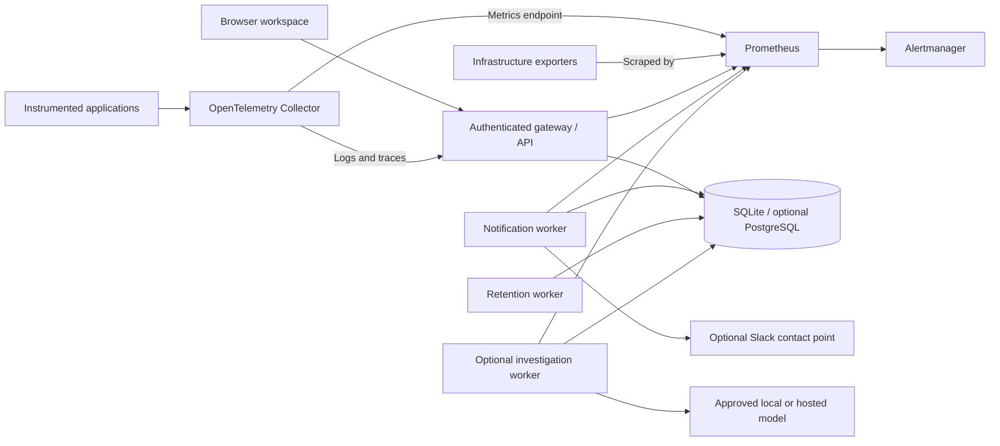

# Montralog 0.8 architecture

Montralog is a self-hosted observability workspace. Docker Compose is the supported installation path. Each customer has a separate stack with its own database, tokens, encryption key, network and volumes. Teams and groups within one stack do not create separate telemetry tenants.

## Components and storage



| Component | Responsibility | Persistence |
|---|---|---|
| Gateway | Gunicorn-hosted browser UI, login/session checks, authorization, ingestion, fixed metric queries and management APIs | Customer application database |
| Application database | Logs, spans, changes, accounts, dashboards, saved connections, alert state, delivery queue, investigation reports and audit records | SQLite volume by default; optional PostgreSQL |
| Collector | Authenticated OpenTelemetry input and export to the gateway/Prometheus endpoint | Durable sending queue volume |
| Prometheus | Scrape configured exporters and collector metrics; query time series; evaluate its own metric rules | Separate time-series volume |
| Alertmanager | Handle Prometheus alert routing | Separate Alertmanager state |
| Notification worker | Evaluate Montralog log/metric rules and persist notification retries | Same customer's application database |
| Retention worker | Apply configured application-record retention | Same customer's application database |
| Investigation worker | Run optional, queued, bounded model analyses with read-only metric tools | Same customer's application database |
| Ollama | Optional local model inference; no exposed host port | Separate customer model-weights volume |

The browser uses login sessions; machine read/ingest tokens have separate scopes. Saved integration credentials are encrypted with the operator-held customer key. TLS, endpoint validation, private-origin approval and DNS/IP pinning protect outbound requests. See [assurance](ASSURANCE.md), [connections](CONNECTIONS.md) and [accounts](ACCOUNTS.md).

## Investigation flow

```mermaid
sequenceDiagram
  actor Admin
  participant UI as Dashboard / Alert
  participant API as Gateway
  participant DB as Customer database
  participant Worker as Investigation worker
  participant Metrics as Saved Prometheus source
  participant Model as Approved model
  Admin->>UI: Ask AI / Investigate
  UI->>API: Source, model, question, scope, optional alert
  API->>DB: Capture evidence and reserve budget; queue report
  Worker->>DB: Claim queued request
  Worker->>Worker: Recheck role, model and sharing policy
  Worker->>Metrics: Initial metric snapshot at captured window
  Worker->>Model: Bounded evidence and runbook
  loop At most two follow-up tools within three total model calls
    Model-->>Worker: Allowlisted snapshot/trend request
    Worker->>Worker: Recheck authorization and source fingerprint
    Worker->>Metrics: Fixed catalog query at captured window
    Worker->>Model: Captured result / missing observation
  end
  Model-->>Worker: Hypotheses, literal quotes, missing evidence, next checks
  Worker->>Worker: Validate IDs, excerpts and bounded output
  Worker->>DB: Persist report and tool trace, or fail closed
  Admin->>UI: Refresh result
  UI->>API: Open own report
  API-->>UI: Evidence, unverified hypotheses and read-only trace
```

Model profiles are operator-defined. The browser receives profile IDs, provider/model names and report data, never provider keys or saved data-source credentials. Hosted processing needs operator-enabled egress plus explicit sharing approval for the selected evidence. The local Ollama default stays on the private network. Gateway and worker must use matching profiles and application versions.

Logs, failed spans, changes and metric queries retain the captured time window. Linked alert filters are authoritative. Metric results are labelled source-wide; the agent does not infer service attribution from unrelated host samples. A valid citation proves only that a referenced excerpt occurred in the snapshot. Causality remains unverified, and the model may abstain when evidence is insufficient.

There are no arbitrary URLs, PromQL, shell tools, general-purpose MCP client or autonomous infrastructure changes. Runbooks supply diagnostic context; they do not grant executable permissions. The separate data-source recheck requires proposal, typed approval, unchanged source configuration and explicit execution within its approval window.

One agent investigation reserves 94,500 conservative units for at most three calls. The optional AI Compose file defaults to 300,000 units/day and 20 submissions/day. Failed attempts retain reservations. Interrupted provider attempts are not silently retried because the provider may already have processed or billed them. See [AI configuration](AI-INVESTIGATIONS.md).

## Reliability and isolation boundaries

SQLite supports a single-node deployment; it is not highly available. Optional PostgreSQL does not make the Collector, Prometheus, workers or whole deployment highly available. Customers must not share application databases, tokens, encryption keys or volumes. Docker/root operators remain trusted.

Collector queues, application ingestion receipts and persisted notification retries cover specific failure scenarios. They are not an end-to-end exactly-once guarantee. Slack is at-least-once and can duplicate after an ambiguous send acknowledgement. Backups need the original tenant identity and encryption key; application database backups do not include Prometheus or Collector volumes.

Deployment acceptance must validate TLS, restore procedures, retention/disk sizing, representative load, actual notification receipt, live company login and any hosted model. [Published reports](reports/README.md) bind test evidence to an exact source/image. [Production acceptance](PRODUCTION.md) records the remaining operator responsibilities.

## Related guides

- [Docker installation and upgrades](CONTAINERS.md)
- [Storage](STORAGE.md) and [customer isolation](TENANCY.md)
- [AI model profiles and evidence rules](AI-INVESTIGATIONS.md)
- [Project structure](PROJECT_STRUCTURE.md)
