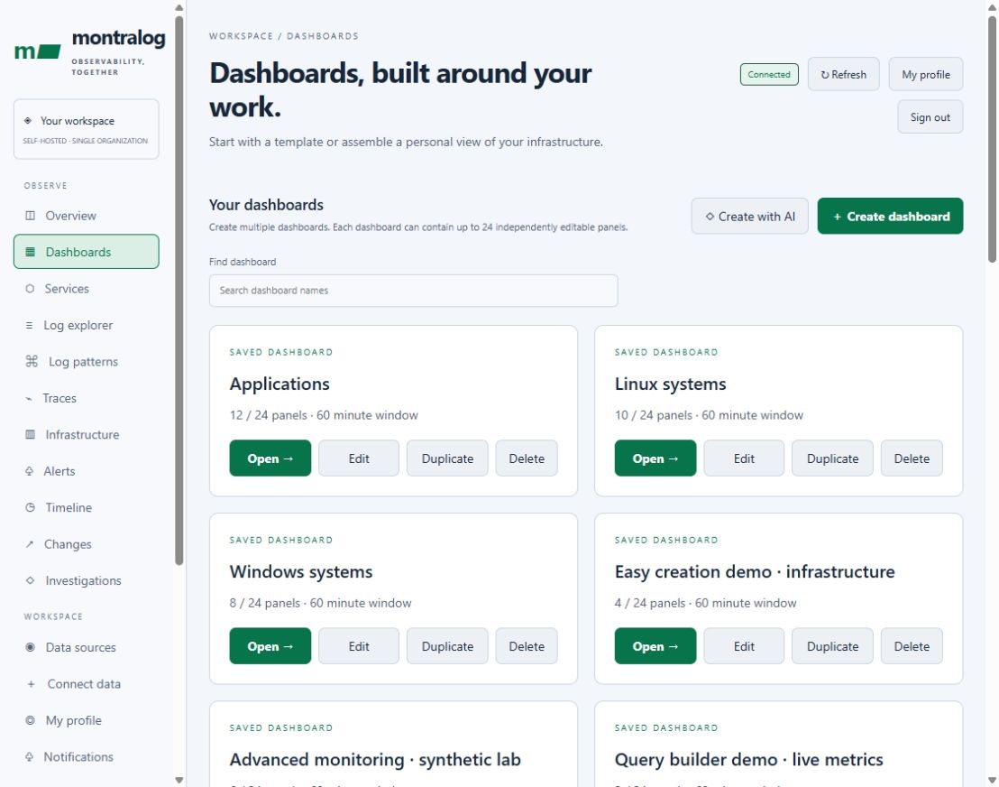
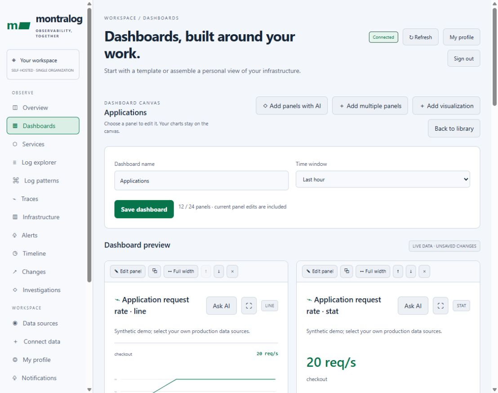
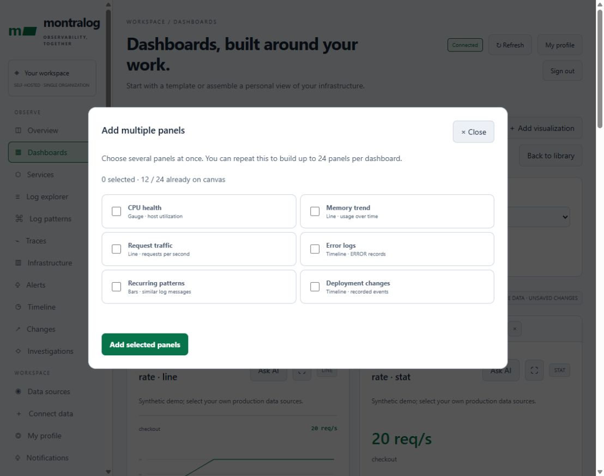
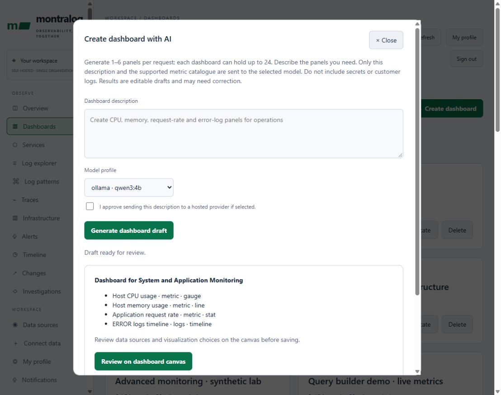

# Dashboards, panels, alerts and notifications

This guide describes the dashboard development preview in [PR #10](https://github.com/montralog/montralog/pull/10). The published 0.8.0 Docker image does not contain all preview features. See [release status](../README.md#release-status) before following preview-only steps.

Browser access uses a username/password session. Fresh installations have no shared default password; create an account through the operator CLI. Dashboards belong to their account owner. Telemetry remains shared within one customer stack; use separate stacks for separate customers.

## Create your first dashboard

1. Open **Dashboards**. Choose **Create dashboard** for an empty canvas, or select a complete starter such as **Windows systems**, **Linux systems** or **Application operations**.
2. Set a dashboard name and time window. A starter is an editable draft; it does not install collectors or exporters.
3. Choose **Add visualization** to configure one panel, or **Add multiple panels** to select several presets.
4. Choose the signal and data source, visualization, metric or record filters. Preview actual data. Missing data remains an empty state.
5. Apply the panel to the canvas. Repeat, edit or reorder panels as needed, then choose **Save dashboard** to persist the dashboard.
6. Return to the library to create another dashboard. Windows, Linux and application views each keep their own panel list.

## Panel editing and saved views

A dashboard supports **0–24 panels**. Starter counts are initial counts, not limits. Windows and Linux starters begin with eight and ten panels. Windows host metrics use the Montralog host collector; this is not a native windows_exporter adapter.

On a saved dashboard, choose a panel's **Edit** action or **Select panel to edit**. On the canvas, edit, duplicate, remove, resize or move individual panels. **Add multiple panels** and **Select multiple presets** add several presets together and may be repeated up to the limit. Apply or discard unfinished panel changes before switching actions. Saving includes current panel edits.

| Signal | Supported views |
|---|---|
| Prometheus metrics | Line, bar, statistic, table, gauge |
| Logs | Table, timeline |
| Log patterns | Table, frequency bars |
| Changes / deployment events | Table, timeline |
| Traces | Table, timeline |

Service/environment filters apply to records. Log panels also support literal message search and severity. Supported metric queries use the guided builder; arbitrary PromQL and free-position layout coordinates are not exposed. Multiple timeline panels can show different signals side by side.

The combined Timeline view is bounded to 100 records per source and at most 120 displayed events. These views are not exhaustive audit exports, and matching patterns or nearby events do not establish causation.

## Guided metric queries and appearance

In **Dashboards → Create dashboard → Add visualization**, choose a data source,
metric, visualization, and aggregation. **Each series** preserves the original
metric; Average, Sum, Minimum, Maximum, and Series count aggregate it. Group by
Instance, Host, Container, Namespace, or Service when that label exists in your
exporter. Missing labels collapse into one unlabeled group; they do not create
resource metadata. Count reports series, not the metric's original unit.

Open **Generated Prometheus query** to inspect the expression before saving.
The server builds queries from supported metrics and validated operations.
This is a guided builder for the bundled metric catalog, rather than an arbitrary
PromQL editor. Log text and severity filters remain literal record filters.
Identical metric queries within one dashboard render share a request; subsequent
refreshes fetch fresh data.

Name and save multiple personal dashboards. Use **Find dashboard** in the library,
**Duplicate** to start an independent copy, and **Switch dashboard** in a saved
view to compare dashboards. Copies retain the data-source references; they do not
copy credentials or change access permissions. Existing owner checks still apply.

**Settings → Appearance → Theme** offers Dark, Light, Midnight, and System. The choice
is stored in this browser and synchronizes across its tabs. System follows the
operating-system preference. This is a device preference, not an account setting.

## Advanced panel controls

The editor supports one-third, half-row and full-row widths, plus compact,
standard and tall heights. Edit, duplicate, resize, reorder and remove controls
have accessible names and tooltips. Choose a panel icon, describe its meaning,
and attach an HTTPS documentation or runbook reference. References open in a
separate tab; Montralog does not fetch their contents.

Metric gauges accept finite minimum, maximum, warning and critical values with
`minimum < warning < critical <= maximum`. Values outside the range are labelled
with their actual value while the bar is clamped. Thresholds colour the display;
they do not create alert rules. Existing dashboards keep their prior layout.

## External backend adapters

| Backend | Panel support | Connection test |
| --- | --- | --- |
| Prometheus | Metric charts, bars, statistics, tables, gauges | Prometheus `up` query |
| VictoriaMetrics, Mimir, Thanos | Same, through their Prometheus-compatible query API | `up` query |
| Loki | Log tables, timelines and sampled patterns | Loki labels API |
| Tempo | Trace search summary tables and timelines | Tempo search API |

Choose a backend in **Connect data**, enter its query base URL, test and save.
Metric backends may become the workspace default. Log and trace panels select
their external source explicitly; a blank source uses Montralog storage.
Use the backend's query-frontend URL, including any required proxy path prefix.
A metrics API test does not prove exporter coverage or support for target/admin
APIs; those vary between compatible servers.

Loki's guided query uses `service_name` and `environment` labels. Without filters
it selects nonempty `service_name`; streams lacking that label are outside this
first adapter. Text uses a literal LogQL filter. Severity is filtered on returned
`severity` or `level` labels. Patterns summarize at most 100 returned records,
not the full result set. No remote logs are imported into local storage.

Tempo filters map to `resource.service.name` and
`resource.deployment.environment.name`. Trace summaries do not include a span
count or local trace details. The AI button is not offered for external log or
trace panels because those records are not yet captured by the AI evidence path.

Authentication supports none, basic, or bearer. Credentials require HTTPS and
are encrypted at rest. Existing SSRF, DNS pinning and redirect protections apply.
Private services need operator destination allowlisting. Custom tenant headers,
AWS SigV4, Azure/Google OAuth, SQL sources, OpenSearch, Elasticsearch, Splunk,
InfluxDB and Datadog are **not implemented adapters** in this change. Do not treat
them as supported simply because they expose HTTP endpoints.

### Upgrade and backup

This development change adds schema migration **8**, recording backend type on
saved connections. Existing sources migrate as Prometheus. Back up the database
and encryption key before upgrading. Older schema-7 binaries cannot open a
migrated database; rollback requires the pre-upgrade database backup and matching
key. Adapter tests use fixtures unless a report explicitly names a live backend.

## Faster creation and expanded inspection

From the dashboard library, use **Infrastructure health**, **Application operations**,
or **Incident investigation** to create a complete editable draft. Review its
sources and save it explicitly. Starters reference supported metrics and local
Montralog records; they do not install exporters or create data sources.

The panel editor offers CPU health, memory trend, request traffic, error logs,
recurring patterns and deployment presets. Pick one, choose the appropriate
source, preview, and add it. Add or discard current edits before switching to
another preset. Appearance, descriptions and reference links live under
**Appearance and context (optional)**. Gauge thresholds stay visible when relevant.

Use the expand icon on a panel to inspect it in a larger dialog. It fetches the
same panel and time window without changing the dashboard definition. Close it
with the close button or Escape to return to the saved view.

## AI-assisted dashboard drafts

Administrators can choose **Create with AI** in the dashboard library. Configure
an approved Ollama or other provider using [the model configuration guide](../README.md#configure-your-ai-model), and
run the existing investigation worker. Jobs are queued and processed outside
browser requests. Use Recent drafts to reopen a job after closing the dialog.

The model receives only your description and the supported metric catalogue.
Do not include secrets in the description. Remote providers require both operator
`MONTRALOG_AI_EGRESS=true` and explicit approval in the form. The existing daily
request/token budget and private provider profiles apply. The worker rechecks
administrator authorization and provider policy before calling the model.

AI proposes **1–6 panels per request**, not a limit on saved dashboards. It can
choose supported metrics, signal types and visualizations; it cannot return raw
queries, datasource IDs, URLs, executable code or arbitrary panel settings.
The response is validated before being offered for review. Click **Review on
dashboard canvas**, inspect sources and panels, then save. Generation alone never
writes a saved dashboard, executes a telemetry query, or changes infrastructure.
Check data sources, thresholds and filters before saving. A generated title mentioning
ERROR does not prove the severity filter is configured. AI output is a suggestion and may be inaccurate. External providers require
private operator credentials; model weights and usage retain their own terms.

For an existing dashboard, open its editor and choose **Add panels with AI**. The
validated proposed panels are appended to that dashboard draft without changing
its name or saving automatically. The combined total must remain at most 24.

For separate worker pools, set `MONTRALOG_AI_WORKER_KIND=panel-draft` on a
dashboard-draft worker and `MONTRALOG_AI_WORKER_KIND=investigation` on an
investigation worker. Leaving it unset processes both types in queue order.
Each worker retains the same authorization, budget and provider restrictions.

## Alert rules

Administrators create metric threshold or matching-log-count rules. Metric rules
use the highest series value for Above or lowest for Below. Log counts cover the
last five minutes with optional literal text, severity, service and environment.
Choose a hold duration and optional Slack contact points. The notification worker
evaluates enabled rules every 30 seconds. Missing metric data is UNKNOWN, not a
healthy/normal observation. Rules transition through NORMAL, PENDING and FIRING.
Firing and resolved transitions go to the in-app inbox. Repeated firing evaluations
do not generate repeated notifications while the state stays FIRING.

Workspace rules are separate from Prometheus's deployment-provisioned rules.
The latter remain visible in Alerts and use Alertmanager's separate delivery
configuration. This UI does not rewrite Prometheus configuration or automatically
route its alerts through the workspace contact points.

## Slack contact points

Under Notifications, add the incoming webhook for a Slack channel and enable it.
The UI never reads back the webhook. Edit with an empty webhook field to retain
the existing secret. Send test explicitly queues one test message; check delivery
history for SENT. A missing webhook is not a connected integration.

The endpoint is restricted to HTTPS `hooks.slack.com/services/...` and redirects
are rejected. Webhook secrets are sealed through the installation secret store. Supported Docker
configuration requires encryption and a private installation key. Preserve that key
with protected backups; losing it prevents recovery of encrypted secrets. See
[secret migration, backup and recovery](ASSURANCE.md).
No log messages are sent to Slack automatically: rule messages contain the rule
name, state, observed value and condition description. Avoid sensitive rule names.

Deliveries persist and retry up to five attempts with backoff. The delivery model
is at-least-once: a crash after Slack accepts a message but before acknowledgement
is recorded can produce a duplicate. Run one notification worker per installation.
Compose runs one worker; Helm uses a SQLite sidecar or a single Recreate PostgreSQL
worker deployment. With Kubernetes network policies, permit outbound HTTPS to the
approved Slack/proxy destination using networkPolicy.extraEgress. No public
inbound webhook endpoint is opened.

References: [Slack incoming webhooks](https://docs.slack.dev/messaging/sending-messages-using-incoming-webhooks/),
[Prometheus query API](https://prometheus.io/docs/prometheus/latest/querying/api/).
## API tokens

Administrators can create read or ingest tokens with 1, 7, 30 or 90 day expiry.
The full secret appears once. Database storage contains only its SHA-256 hash,
prefix, scope, expiry, last-use timestamp and revocation status. Read tokens
cannot ingest; ingest tokens cannot read telemetry or administer browser accounts.
Revocation takes effect on subsequent requests. Tokens are installation-scoped,
not scoped to an individual service or tenant.

Use gateway port 8080 for JSON ingestion or OTLP HTTP `/v1/logs`, `/v1/traces` and
`/v1/metrics`. Metrics are forwarded to the configured private collector. Direct
collector ports 4317/4318 still use the separate deployment-level ingest token
from the operator's Secret/.env. Those bootstrap credentials are managed through
deployment configuration, not through the managed token table.
