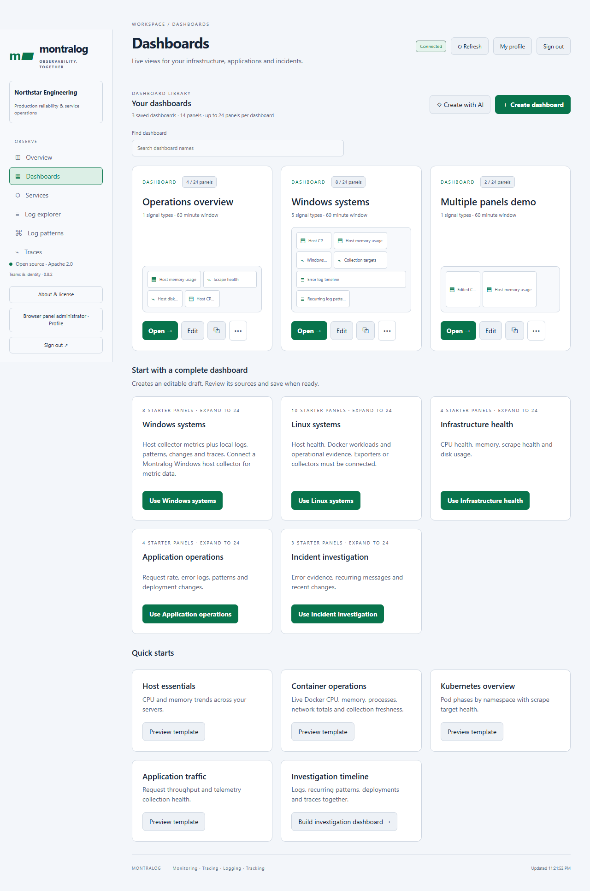
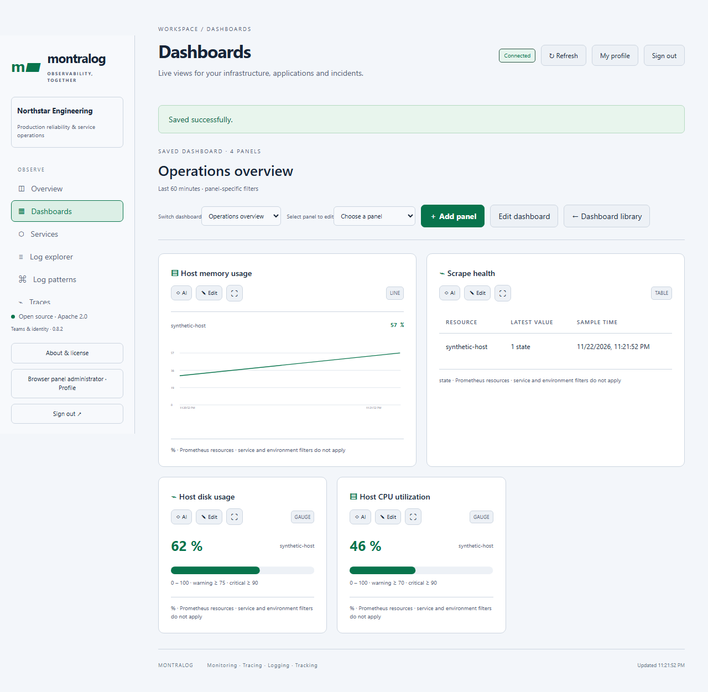

# Workspace and dashboard preview

These changes are under review in PR #13 and are not included in the published 0.8.2 Docker image. Evaluate them in a separate stack until review and release checks complete.

## Organization settings

Open **Settings > Organization**. Administrators can save the organization name and description. The sidebar updates and values survive reloads. Viewers can read these details but cannot change them. Updates require administrator authorization and CSRF protection, and create an access audit entry.

These are display settings only; they do not change customer identity, account ownership, API tokens, encryption keys or isolation. Appearance controls remain in Settings, alongside shortcuts to data sources, access and notifications.

## Dashboard workflow

Dashboard cards show panel layout, signal types and time window. Layout previews show structure without invented telemetry. Open, edit or duplicate a dashboard, or delete it through its overflow menu.

Each dashboard supports up to 24 panels. Choose **Add panel** on a saved dashboard to open its canvas and inspector. Select a signal, source, visualization and query, preview the results and apply the panel. Presets are collapsible and support multiple selections.

Drag a panel by its handle to reorder it, or use Move up and Move down with the keyboard. Save the dashboard to persist changes. On wide screens the inspector reserves space beside the canvas. Back to library remains accessible.

## Upgrade and rollback

This development branch introduces schema **9** for organization display settings. Back up the database and preserve its matching encryption key before upgrading. Follow the [backup and restore guide](ASSURANCE.md), test restoration in an isolated stack, and upgrade gateway and workers together.

An older schema-8 application cannot open a schema-9 database. Rollback requires the pre-upgrade database backup and matching key. Never point an older image at the upgraded volume. Use separate preview volumes, credentials and encryption keys.

## Verification and limits

The browser suite covers organization persistence and viewer restrictions, dashboard cards, panel creation, drag reorder and saved order, editing, presets and existing workflows. SQLite and PostgreSQL tests cover organization settings. Separate [dashboard query evidence](reports/dashboard-scale/README.md) documents a synthetic ten-million-record read benchmark, not production ingestion capacity or independent security certification.

Screenshots contain synthetic data. Missing telemetry remains an empty state. AI panel proposals use the configured provider and require explicit review and save.
